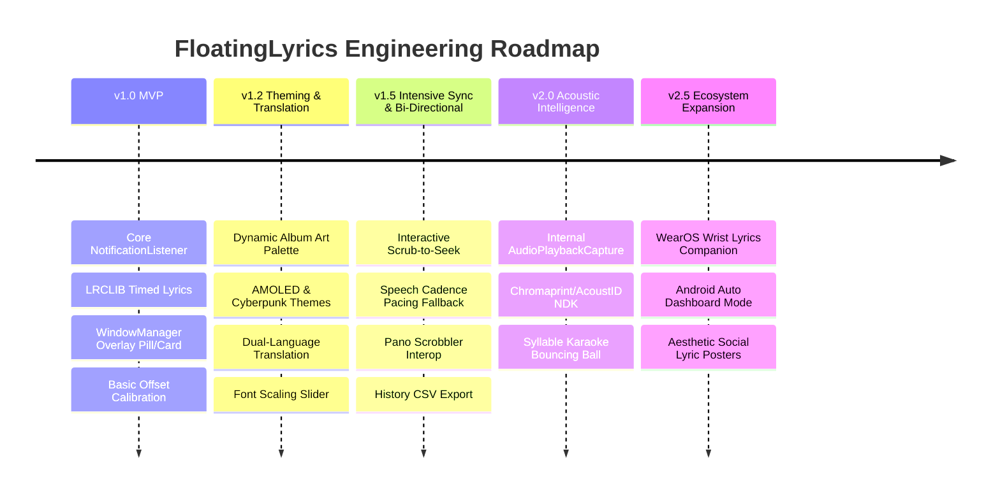
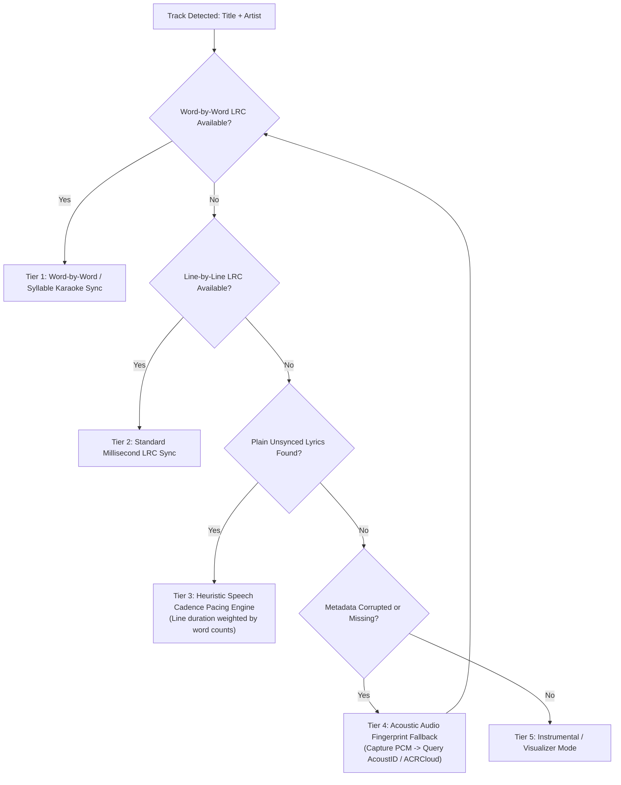
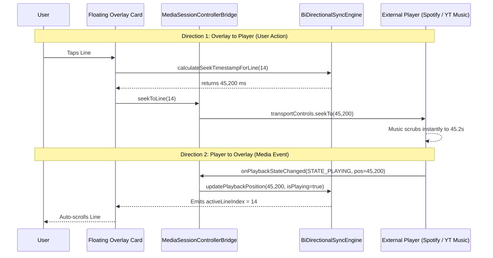

# Technical Implementation Plan: Android Floating Timed Lyrics App (Complete Architecture)

## Goal Description
Build an advanced, highly customizable Android application that displays synchronized lyrics in a morphing floating overlay (Pill ↔ Floating Card) powered by Jetpack Compose. The app automatically intercepts playing music across all Android media apps, cleans noisy track metadata, guesses song titles using fuzzy algorithms and Last.fm corrections, aggregates lyrics across multiple APIs (LRCLIB, Netease, Genius), provides audio fingerprinting fallbacks, logs listening history with CSV export, supports real-time multi-tier translation, and features bi-directional interactive playback controls.

---

## 1. Gap Analysis: What Was Missing & How We Solved It

| Area | Missing Gap / Edge Case | Architectural Solution |
| :--- | :--- | :--- |
| **Audio Session Conflicts** | User scrolling TikTok/Instagram while Spotify is backgrounded, causing conflicting audio sessions. | Filter media sessions by `AudioAttributes.USAGE_MEDIA` and prioritize active, playing controllers with longest continuous duration. |
| **Unsynced / Plain Lyrics** | When only static, plain lyrics are available, standard lyric apps leave text frozen or require manual scrolling. | **Heuristic Speech Cadence Pacing Engine (Tier 3)**: Dynamically estimates timestamps for each line based on track duration, word count, and typical vocal intro/outro windows. |
| **Bi-Directional Interactive Seeking** | Traditional lyric overlays are read-only; tapping lyrics does nothing. | **Bi-Directional Media Controller Bridge**: Tapping any line in the overlay calls `mediaController.transportControls.seekTo(line.timestampMs)`, jumping Spotify / YouTube Music straight to that moment. |
| **Language Barriers** | Foreign language music (J-Pop, K-Pop, Latin, Anime, French) is illegible or unpronounceable to users. | **Dual-Language Pipeline**: Extracts native synced translations (`tlyric`) or runs on-device Google ML Kit translation, presenting phonetic romanization (Romaji/Pinyin) and translation beneath the original text. |
| **Visual Customization** | Hardcoded dark mode or unreadable tiny fonts on high-DPI screens. | **Dynamic Theming & Font Scaling**: Presets for AMOLED Black, Frosted Glass, Neon Cyberpunk, Paper Light, and dynamic album-art Palette extraction, with 4-level font scale and opacity slider. |
| **OEM Battery Throttling** | Samsung OneUI / Xiaomi HyperOS killing background overlay services after 10 minutes. | Android foreground service with `FOREGROUND_SERVICE_TYPE_MEDIA_PLAYBACK` + proactive prompt to disable battery optimization. |

---

## 2. Future Development Roadmap

- **v1.0 (MVP Foundation)**:
  - Background `NotificationListenerService` & `MediaSessionManager`.
  - Floating Pill ↔ Card morphing via Jetpack Compose.
  - LRCLIB primary API integration.
- **v1.2 (Visual Polish & Internationalization)**:
  - Theme engine (AMOLED, Frosted Glass, Neon Cyberpunk, Dynamic Palette).
  - Font scaling presets (`COMPACT`, `BALANCED`, `COMFORTABLE`, `JUMBO`).
  - Dual-language translation (Netease `tlyric` + ML Kit offline fallback).
- **v1.5 (Advanced Controls & Analytics)**:
  - Bi-directional interactive line seeking.
  - Plain lyric cadence pacing fallback.
  - Room listening history with Storage Access Framework (SAF) CSV export.
  - Pano Scrobbler bi-directional broadcast integration.
- **v2.0 (Acoustic AI & Karaoke Precision)**:
  - Android 10+ `AudioPlaybackCapture` and AcoustID fingerprinting.
  - Word-level karaoke bouncing ball animation.
- **v2.5 (Cross-Device Ecosystem)**:
  - Wear OS companion app showing active lyrics on smartwatches.
  - Aesthetic shareable typography poster card generator.

---

## 3. Intensive Fallback Matrix for Timed Sync

### Heuristic Cadence Pacing Algorithm (Tier 3)
When an obscure or unindexed indie song only has plain text lyrics:
1. Deduct 8% intro time and 5% outro time from total track duration.
2. Calculate total words across all lyric verses.
3. Assign each line a proportional time slice based on its syllable/word density.
4. Synthesize artificial timestamps so the overlay smoothly scrolls with the song instead of remaining static.

---

## 4. Bi-Directional Control Architecture

---

## 5. Theming & Font Scaling System

### Theme Presets
- **`AMOLED_DARK`**: `#000000` pitch black surface, `#FFFFFF` high contrast text, Spotify green accents.
- **`FROSTED_GLASS`**: Translucent `#2C3240` with 65% opacity, soft cyan glow, blur backdrop.
- **`NEON_CYBERPUNK`**: `#0A0017` deep purple canvas with Electric Cyan `#00FFFF` active lines and Neon Pink `#FF007F` translations.
- **`DYNAMIC_PALETTE`**: Real-time Android `Palette` extraction from the song's album art.
- **`PAPER_LIGHT`**: High contrast daylight mode for outdoor readability.

### Font Scale Presets
- **`COMPACT`**: `13sp` text / `18sp` line height (ideal for small screens or busy gaming overlays).
- **`BALANCED`**: `16sp` text / `22sp` line height (standard default).
- **`COMFORTABLE`**: `20sp` text / `28sp` line height (easy reading from a distance).
- **`JUMBO`**: `25sp` text / `34sp` line height (accessibility / karaoke mode).

---

## 6. Implementation Code Map

All code is implemented cleanly within the dedicated project workspace:

- **Theme Engine**: [`OverlayTheme.kt`](file:///D:/Nokia_Interview_Prep/floating_lyrics_app/src/main/java/com/lyrics/floating/ui/theme/OverlayTheme.kt)
- **Preferences & Settings**: [`OverlayPreferences.kt`](file:///D:/Nokia_Interview_Prep/floating_lyrics_app/src/main/java/com/lyrics/floating/data/preferences/OverlayPreferences.kt)
- **Translation Data Models**: [`DualLanguageLyricLine.kt`](file:///D:/Nokia_Interview_Prep/floating_lyrics_app/src/main/java/com/lyrics/floating/domain/translation/DualLanguageLyricLine.kt)
- **Translation Pipeline**: [`TranslationEngine.kt`](file:///D:/Nokia_Interview_Prep/floating_lyrics_app/src/main/java/com/lyrics/floating/domain/translation/TranslationEngine.kt)
- **Intensive Fallback Sync Engine**: [`BiDirectionalSyncEngine.kt`](file:///D:/Nokia_Interview_Prep/floating_lyrics_app/src/main/java/com/lyrics/floating/domain/sync/BiDirectionalSyncEngine.kt)
- **Bi-Directional Media Controller**: [`MediaSessionControllerBridge.kt`](file:///D:/Nokia_Interview_Prep/floating_lyrics_app/src/main/java/com/lyrics/floating/service/media/MediaSessionControllerBridge.kt)
- **Appearance Settings Sheet**: [`ThemeAndFontSettingsSheet.kt`](file:///D:/Nokia_Interview_Prep/floating_lyrics_app/src/main/java/com/lyrics/floating/ui/overlay/ThemeAndFontSettingsSheet.kt)
- **Interactive Lyrics Overlay Card**: [`FloatingLyricsCardView.kt`](file:///D:/Nokia_Interview_Prep/floating_lyrics_app/src/main/java/com/lyrics/floating/ui/overlay/FloatingLyricsCardView.kt)
