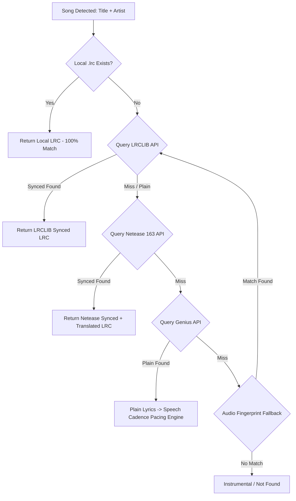

# Comprehensive Guide: Lyrics Sources & Aggregation Strategy

This document provides a complete technical analysis of all available lyrics providers, APIs, scraping techniques, and offline vaults for the **FloatingLyrics** Android app.

---

## 1. Source Comparison Matrix

| Source | Synced LRC | Syllable / Word-by-Word | Translations & Phonetics | Cost / Auth | Reliability & Hit Rate | Best Use Case |
| :--- | :---: | :---: | :---: | :---: | :---: | :--- |
| **LRCLIB** |  Yes | ❌ No | ❌ No | **100% Free** (No API Key) | **High** (Western Pop, Rock, Indie) | **Default Primary Provider** |
| **Netease Cloud Music (163)** |  Yes |  Yes (`klyric`) |  Yes (`tlyric` & `romalrc`) | **Free Public API** | **Vast** (Global, Anime, Asian, Pop) | **Primary for Translations** |
| **Kugou / QQ Music** |  Yes |  Yes | ❌ No | **Free Public API** | **Very High** (International & OSTs) | Secondary Sync Fallback |
| **Local Storage / Vault** |  Yes |  Yes | Optional | **100% Offline / Private** | **100%** (User files) | High-fidelity offline listening |
| **Genius** | ❌ (Plain Only) | ❌ No | ❌ No | Free API (Client Token) | **Extremely High** | Annotations, Trivia, Plain Text Fallback |
| **Musixmatch** (Token Method) |  Yes |  Yes (TTML/JSON) |  Yes | Free (App Token emulation) | **World's Largest Catalog** | Emergency fallback for obscure songs |
| **Self-Hosted** (Navidrome/Subsonic) |  Yes | Optional | Optional | User's Own Server | Unlimited | Audiophiles & self-hosters |

---

## 2. Deep Dive: Core Providers

### 1. LRCLIB (Primary Recommendation)
- **Website**: [https://lrclib.net](https://lrclib.net)
- **Why it’s ideal**:
  - Open-source, community-driven database dedicated exclusively to synchronized LRC.
  - Zero registration, zero API keys, no restrictive rate limits.
  - Clean REST API returning both `syncedLyrics` (LRC format) and `plainLyrics`.
- **API Endpoints**:
  - **Exact Match**: `GET https://lrclib.net/api/get?track_name={title}&artist_name={artist}&album_name={album}&duration={seconds}`
  - **Fuzzy Search Fallback**: `GET https://lrclib.net/api/search?q={artist}+{title}`

---

### 2. Netease Cloud Music (NetEase 163)
- **Why it’s irreplaceable**:
  - Holds the world's largest public database of multi-lingual synchronized lyrics.
  - **Unique Feature: 4 Concurrent Lyric Streams**:
    1. `lrc.lyric`: Original synchronized LRC.
    2. `tlyric.lyric`: **Synchronized translation lines** (e.g. English translation timestamped in exact lockstep).
    3. `romalrc.lyric`: **Phonetic romanization** (Romaji for Japanese, Pinyin for Chinese, Hangul romanization).
    4. `klyric.lyric`: Syllable-level karaoke timestamps.
- **API Workflow**:
  1. Search Song ID:
     ```
     GET https://music.163.com/api/search/get/web?s={artist}+{title}&type=1&limit=5
     ```
  2. Fetch Lyrics Payload:
     ```
     GET https://music.163.com/api/song/lyric?id={songId}&lv=-1&kv=-1&tv=-1&rv=-1
     ```

---

### 3. Local Filesystem & Offline Vault
- **Zero-Network, Zero-Latency, Complete Privacy**:
  - Searches for `.lrc` files placed alongside media files in device storage:
    - Same folder as audio: `/Music/Queen/Bohemian Rhapsody.lrc`
    - Dedicated app vault: `/sdcard/Music/Lyrics/Queen - Bohemian Rhapsody.lrc`
  - Reads ID3v2 metadata frames directly from MP3/FLAC:
    - **`SYLT`** (Synchronized Lyric/Text frame)
    - **`USLT`** (Unsynchronized Lyric/Text frame)

---

### 4. Genius API & Scraper (Plain Lyrics Fallback)
- **Why use it**:
  - Unmatched catalog of obscure indie songs, rap tracks, underground releases, and spoken word.
  - Returns song trivia, producer credits, and line-by-line annotations.
- **Workflow**:
  - Search Genius API: `GET https://api.genius.com/search?q={query}`
  - Parses the lyric webpage JSON state (`window.__PRELOADED_STATE__`) or clean HTML container to extract verified text.
  - Feeds into our **Heuristic Cadence Pacing Engine (Tier 3)** so plain text still auto-scrolls with the song!

---

### 5. Musixmatch Client Token (Optional Advanced Engine)
- **Background**: Musixmatch powers lyrics for Spotify, Apple Music, and Instagram. Their official developer API is paid and truncates lyrics to 30%.
- **Community Approach**:
  - Open-source tools (like `syncedlyrics` and `spicetify`) emulate the official desktop/mobile client:
    1. Call `https://apic-desktop.musixmatch.com/ws/1.1/token.get?app_id=web-desktop-app-v1.0` to acquire a temporary user token.
    2. Call `macro.subtitles.get` with track title and artist to receive word-by-word synced TTML/JSON.
  - Can be toggled on by users in "Advanced Experimental Sources" settings.

---

## 3. Multi-Source Cascading Architecture



---

## 4. Source Switching in the UI
In the floating overlay, users can see which source is currently active (e.g. badge showing `[LRCLIB]`). Tapping the badge opens a quick bottom sheet displaying:
- **Active Source**: LRCLIB (Synced)
- **Alternatives Found**:
  - Netease Cloud (Synced + Translated Available) `[Switch]`
  - Local Storage (None)
  - Genius (Plain Text + Annotations) `[View Trivia]`
